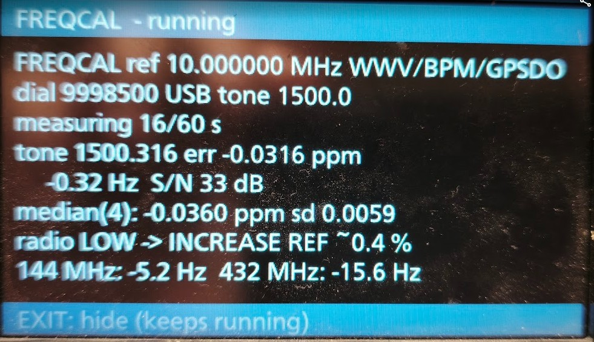

# FREQCAL - REF Adjust helper

FREQCAL listens to a GPS-locked carrier and shows how far the radio's reference oscillator is off,
and which way, and roughly how much, to change **REF Adjust**. It never changes a radio setting itself.



## Use
1. Copy `FREQCAL.APP` and `FREQCAL.CFG` to the radio's `Apps` folder (`\IC-705\Apps\`).
2. Tune **USB** about 1.5 kHz below a standard-frequency station. FREQCAL picks the station from the dial:

   | Station | Carrier | Dial (USB) |
   |---|---|---|
   | WWV / BPM | 2.5 / 5 / 10 / 15 MHz | 2.4985 / 4.9985 / 9.9985 / 14.9985 MHz |
   | WWV | 20 / 25 MHz | 19.9985 / 24.9985 MHz |
   | RWM | 4996 / 9996 / 14996 kHz | 4.9945 / 9.9945 / 14.9945 MHz |
   | CHU | 3330 / 7850 / 14670 kHz | 3.3285 / 7.8485 / 14.6685 MHz |
   | GPSDO | 10 MHz | 9.9985 MHz |

   Any tone between 200 and 3300 Hz works. On another frequency the app shows which dial to use.
3. Turn **NOTCH, NR and NB off**.
4. **MENU > SET > Apps > FREQCAL.** EXIT only hides the window; the app keeps running.
5. After a few 60 s windows read the advice, e.g. `radio LOW -> INCREASE REF ~0.4 %`. Change REF Adjust
   (MENU > SET > Function > REF Adjust) and wait for the next result until it says `OK`.
6. To stop: MENU > SET > Apps, tap FREQCAL, STOP (or power off the radio).

From the author's tests, RWM 9996 kHz is the cleanest reference in Europe: one carrier, strong signal.
On 10 MHz, WWV, WWVH and BPM can be heard together a few tenths of a Hz apart.

## Screen
```
FREQCAL ref 10.000000 MHz WWV/BPM/GPSDO     station picked from the dial
dial 9998500 USB tone 1500.0                dial, sideband, expected tone
measuring 39/60 s                           progress of the current window
tone 1500.162 err -0.0162 ppm               last window: measured tone and radio error
     -0.16 Hz  S/N 31 dB                    error in Hz at the dial, signal-to-noise
median(5): -0.0160 ppm sd 0.0030            robust average of the last windows
radio LOW -> INCREASE REF ~0.2 %            advice in REF Adjust menu %
144 MHz: -2.3 Hz  432 MHz: -6.9 Hz          what the error means on VHF/UHF
```
`err` positive = the radio is high. A rejected window shows the reason: `(low S/N)` or
`(2 carriers .. dB)`. `CHECK` after the median means more than 1 ppm (possibly the wrong carrier).

## How it measures
- Mixes the 8 kHz receive audio down at the expected tone, coarse DFT search (0.05 Hz steps)
  within +-1.5 ppm of the reference (10 MHz: +-15 Hz), so spurs further away are ignored.
- Over each window a zoom DFT (0.005 Hz bins, interpolated) on the strongest carrier gives the tone.
  If a second carrier is within `minsep` dB (6), the window is skipped.
- The carrier is searched again every 3 windows; the result line uses the median of the last 6 windows.
- IC-705: REF Adjust moves the reference by about **0.1 ppm per 1 %** (measured; `step=0.10`).
  Other radios may differ; `cal=1.0` measures it (see below).
- With a transverter slot active the error includes the transverter LO, so no REF advice is given.

## FREQCAL.CFG
| Key | Default | Meaning |
|---|---|---|
| `ref` | auto | Carrier frequency in Hz. Leave out to pick the station from the dial; set it for any other GPS-locked carrier (e.g. a beacon) |
| `win` | 60 | Measurement window in seconds (5..120) |
| `search` | auto | Search half-width in Hz (3..80). Auto = 1.5 ppm of the reference |
| `minsnr` | 12 | Minimum S/N in dB (per 0.05 Hz bin) to accept a window |
| `minsep` | 6 | The strongest carrier must be this many dB above a second one |
| `step` | 0.10 | ppm change per +1 % REF Adjust |
| `cal` | 0 | Not 0: measure `step`. The app asks you to raise REF Adjust by this many %, detects the change by itself (3 min) and shows the step |
| `refnow` | - | Optional: REF Adjust value now (%), only to print a target value |
| `log` | 1 | Write `FREQCAL.TXT` |

## Log
`Apps\FREQCAL.TXT`, one line per window: time, dial, sideband, transverter slot, tone, phase-fit
offset, error in Hz and ppm, S/N, phase RMS, second-carrier separation and tone, accepted (1/0).

## Build
See the [main README](../../README.md#build-from-source). Built with the public ICAP SDK only.
